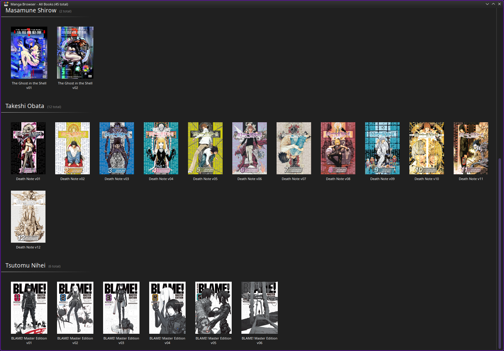

# mkMangaBrowser

A Qt6 app that shows a manga/comic collection as a grouped cover overview, with per-book chapter metadata.
It is the successor of an earlier AutoHotkey script; the grid view and the thumbnail cache are shared with
[mkGameBrowser](https://github.com/KrokusPokus/mkGameBrowser).

mkMangaBrowser is a browser, not a reader: books are opened in the system image viewer
([mkImageViewer](https://github.com/KrokusPokus/mkImageViewer) is the intended reader).
For now only unpacked books (image files in a folder) are supported; CBZ may follow later.



## Data structure

```
<Manga>/<Author>/<Author (Date) Title>/
    000.jpg … NNN.jpg   pages (any image format Qt can read), naturally sorted
    metadata.conf       book metadata (UTF-8 without BOM)
```

The metadata format is specified in [doc/MetadataFormat.md](doc/MetadataFormat.md).
A book folder without `metadata.conf` gets a new one, generated from the folder names. After setting `chapters=N`, F5 adds empty entries for chapters 1..N and removes entries beyond N.
Folders whose name starts with `_` are ignored.

## Usage

- **Right-click on empty space:** Group (author, series, type, title, year, year/month), sort, label.
- **Double-click on a group header:** show only this group (filter) and switch to a grouping that still separates the
  remaining books (after author: series or type; after type: author or series; after series: type). If none does,
  the books are shown without grouping (no header) in the **chapter view**: each book starts a new row, followed by
  one thumbnail per defined chapter (`chN_cover`, otherwise `chN_start`); double-clicking a chapter opens its start page.
  Filters can be stacked;
  **Backspace** or the mouse button **Back** removes the last one. Active filters are shown in the title bar.
- **Right-click on a cover:** Open, Chapters, Edit meta file, Open folder, Google.
- **Double-click:** open the first page in the system image viewer. **Hover:** info window with chapters.
- **Ctrl+F:** filter bar (every word must occur in names, type, date or chapter titles). Esc clears and closes it.
- **Keys:** A–Z/0–9 jump to the group; Page Up/Down, Home/End, arrow keys (horizontal with Shift);
  Ctrl+E/G/L for the book under the mouse; F1 help; F5 reload; Esc closes the filter bar or quits.

## Thumbnail cache

`~/.cache/mkMangaBrowser/ThumbsCache<PixelHeight>/` – per book `<AuthorFolder>_<BookFolder>.png` and `.grey.png`, plus `_List.txt`. Same format and behavior as in mkGameBrowser.

## Configuration

`~/.config/mkProjects/mkMangaBrowser.conf` holds only `[Paths] MangaDir`. On first start you are asked for the folder (or use `mkMangaBrowser --manga <folder>`).
View, window geometry and scroll position are stored in `~/.local/state/mkProjects/mkMangaBrowser_state.conf`.

## Requirements

- Qt ≥ 6.5 (Core, Gui, Widgets, LinguistTools), CMake ≥ 3.19 and a C++ compiler
- An image viewer registered as the default application for the page format, ideally mkImageViewer

On Arch Linux:

```bash
sudo pacman -S --needed base-devel cmake qt6-base qt6-tools
```

## Building and installing

```bash
git clone https://github.com/KrokusPokus/mkMangaBrowser.git
cd mkMangaBrowser
cmake -B build -DCMAKE_BUILD_TYPE=Release -DCMAKE_INSTALL_PREFIX=/usr
cmake --build build --parallel
sudo cmake --install build                   # installs system-wide
sudo xargs rm < build/install_manifest.txt   # uninstalls again
```

For development, `./build.sh` builds into `build/bin/` without installing, and `./build_lupdate.sh` updates the
translation sources in `i18n/*.ts`.

## License

GPL-3.0-only, see [LICENSE](LICENSE).
